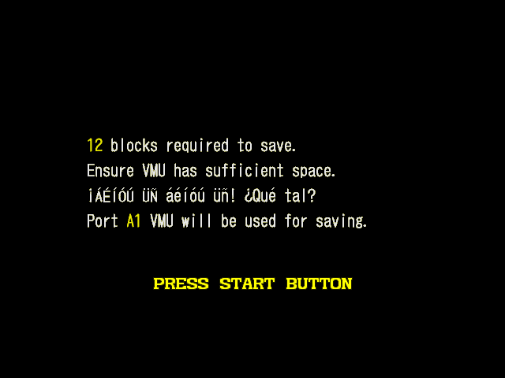

# Capcom vs. SNK 2 — Dreamcast ES

Traducción parcial al español de España, basada en el [parche inglés v1.2 de Derek Pascarella y su equipo](https://github.com/DerekPascarella/Capcomvs.SNK2-EnglishPatchDreamcast).

Se traducen los diálogos y las descripciones. Los movimientos especiales, comandos, nombres propios y títulos se conservan en inglés.

## Primera versión preliminar

La versión `v0.1.0-alpha.1` incorpora el primer borrador de:

- Diálogos de victoria: 8.496 entradas físicas, incluidas tres de símbolos.
- Finales y narración: 498 entradas, conservando títulos y marcadores especiales.
- Descripciones de modos y opciones: 26 líneas.
- Bonus Mode: entrevistas y descripciones; 456 segmentos revisados, con 179 traducidos y el resto conservados.
- Fuente estrecha con `áéíóúüñÁÉÍÓÚÜÑ¿¡`.

Las entradas físicas no equivalen a frases o conversaciones completas. Se han identificado 4.992 cuadros de victoria, algunos con dos hablantes. No se cambian los movimientos ni las reglas del juego.

**Estado: alpha para pruebas.** El arranque y los caracteres españoles se han comprobado en Flycast. Sigue pendiente una revisión extensa de combates, finales y navegación de Bonus Mode, además de pruebas en Dreamcast real. Los subtítulos del vídeo de Bonus Mode siguen en inglés. Los avisos de sistema, controles, títulos e imágenes con texto quedan fuera de esta primera versión.



## Aplicación del parche

Descarga el archivo `.dcp` de [Releases](https://github.com/D4n1984/cvs2-Dreamcast-ES/releases) y aplícalo a la **imagen japonesa original sin modificar** con [Universal Dreamcast Patcher](https://github.com/DerekPascarella/UniversalDreamcastPatcher), versión 1.3 o posterior. Admite imágenes GDI de estilo TOSEC y CUE de estilo Redump. El DCP ya incorpora la base inglesa: no se aplica sobre una imagen parcheada en inglés.

La pista de datos original compatible tiene este MD5:

```text
FF8E199324FC11D4F638E5C99315CDBB
```

No se incluyen el juego ni imágenes de disco. Las ROM, recursos extraídos y herramientas binarias locales están excluidos de Git.

## Textos y construcción

- `traduccion/*.tsv`: textos editables, una entrada por ID, en UTF-8.
- `traduccion/*.csv`: catálogos con original, inglés y español para revisión.
- `analisis/agrupacion-dialogos.json`: referencias y agrupaciones de los cuadros de victoria.
- `herramientas/`: extracción, validación, fuente, reconstrucción y empaquetado.
- `docs/CONSTRUIR.md`: requisitos y procedimiento reproducible.

El primer borrador y la revisión dirigida cuentan con asistencia de IA; no sustituyen la revisión lingüística y visual de todo el juego. Comunica los errores con el ID del catálogo, personaje, rival y captura cuando sea posible.

Primero se completará y revisará la traducción. Después se estudiará un complemento opcional de texturas de mayor resolución y, finalmente, la viabilidad de apariencias adicionales que conserven los personajes originales.

## Créditos

La programación, traducción inglesa, gráficos, correcciones y contenido extra originales pertenecen al equipo acreditado en el [README original](docs/README-original-ingles.md): Derek Pascarella (ateam), Duralumin, Jesuszilla, Tortita, Justin Gibbins, rob2d, Silentscope y hasnopants. Las entrevistas inglesas son traducciones de Benjamin Roodberg. Sus créditos se conservan dentro del juego.

Este fork añade los textos españoles y las herramientas de construcción y comprobación. Capcom y SNK conservan los derechos sobre el juego y sus personajes.
